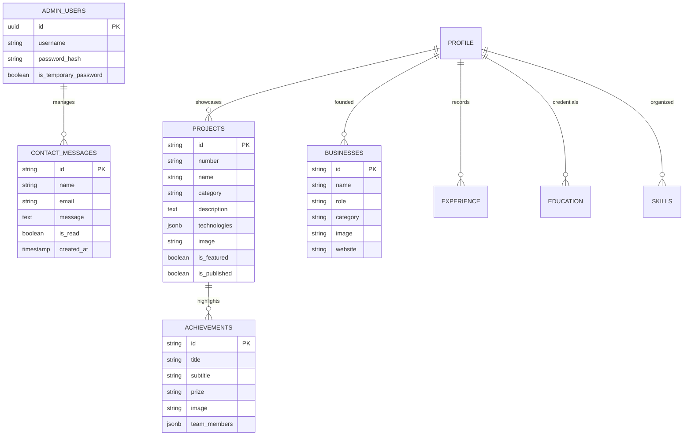

# ANSAB PORTFOLIO — COMPLETE BACKEND & ADMIN CMS INTEGRATION

This document outlines the architecture, database migrations, Supabase storage configuration, authentication workflows, and deployment instructions for the **Ansab Portfolio** project.

---

## 1. Project Configuration Summary

### Environment Variables
Your `.env` and `.env.local` files have been configured with your live Supabase project credentials:

```ini
# Supabase Project Configuration
VITE_SUPABASE_URL=https://vpxzaswitrzbsjktcvbe.supabase.co
VITE_SUPABASE_PUBLISHABLE_KEY=sb_publishable_qyBLzVxZCptjVNSea4zL1g_d2jsJKMt
VITE_SUPABASE_ANON_KEY=sb_publishable_qyBLzVxZCptjVNSea4zL1g_d2jsJKMt

# Admin JWT Signing Secret
ADMIN_JWT_SECRET=ansab-super-secret-jwt-key-2026-production

# Initial Admin Credentials (Username: ANSAB, Temp Dev Password: 2006)
INITIAL_ADMIN_USERNAME=ANSAB
INITIAL_ADMIN_PASSWORD=2006
```

> [!NOTE]
> `.gitignore` has been updated and strictly excludes `.env`, `.env.local`, and any `.env.*` variants to ensure zero secrets or publishable keys are accidentally committed to GitHub.

---

## 2. Supabase SQL Migrations

All database scripts have been created and placed in the project's [`supabase/`](file:///c:/Users/muham/OneDrive/Desktop/WEB/supabase) directory:

| File | Purpose |
| :--- | :--- |
| [`supabase/schema.sql`](file:///c:/Users/muham/OneDrive/Desktop/WEB/supabase/schema.sql) | Complete database schema with Row Level Security (RLS) policies for all 15 tables. |
| [`supabase/seed.sql`](file:///c:/Users/muham/OneDrive/Desktop/WEB/supabase/seed.sql) | Initial seed data containing all your portfolio content and the `ANSAB` admin user. |
| [`supabase/storage.sql`](file:///c:/Users/muham/OneDrive/Desktop/WEB/supabase/storage.sql) | Buckets (`portfolio-images`, `portfolio-resumes`) and storage access policies. |

### How to Apply the Migrations in Supabase:
1. Open the [Supabase Dashboard](https://supabase.com/dashboard/project/vpxzaswitrzbsjktcvbe).
2. Go to the **SQL Editor** in the left sidebar.
3. Click **New Query**.
4. Copy the entire content of [`supabase/schema.sql`](file:///c:/Users/muham/OneDrive/Desktop/WEB/supabase/schema.sql) and click **Run**.
5. Copy the entire content of [`supabase/seed.sql`](file:///c:/Users/muham/OneDrive/Desktop/WEB/supabase/seed.sql) and click **Run**.
6. Copy the entire content of [`supabase/storage.sql`](file:///c:/Users/muham/OneDrive/Desktop/WEB/supabase/storage.sql) and click **Run**.

---

## 3. Database Schema Overview



### Row Level Security (RLS) Rules:
- **Public Visitors**: Can only `SELECT` published rows (`is_published = true`) and can `INSERT` into `contact_messages` and `analytics_events`.
- **Private Data**: `contact_messages`, `admin_users`, and draft projects are protected from public inspection.
- **Admin**: Can perform full `SELECT`, `INSERT`, `UPDATE`, and `DELETE` on all entities.

---

## 4. Admin CMS Portal (`/admin` and `/admin/login`)

### Initial Account:
- **Username**: `ANSAB`
- **Temporary Password**: `2006`

### Security Flow:
1. When logged in with `2006`, a prominent **Security Warning Banner** appears across the dashboard indicating that a temporary development password is in use.
2. The **Change Password** modal verifies the current password and enforces complexity rules (minimum 8 characters, at least 1 number or special symbol, cannot be `2006`).
3. Passwords are encrypted with `bcryptjs` and session tokens are signed with HMAC-SHA256.
4. Failed login attempts are rate-limited to protect against brute-force attacks.

### Dashboard Sections:
- **Overview**: High-level KPIs (Total projects, achievements, businesses, unread contact messages, quick action buttons).
- **About Me**: Biography, tagline, hero statement, core philosophy, and identity bento cards.
- **Projects**: Complete CRUD, image uploads, reordering, draft/published toggle, and featured project selection.
- **Achievements**: CONVERGE 2026 spotlight award, stats, secondary achievements, and media press clipping manager.
- **Experience**: Cyra Learnings internship narrative, duration, location, skills, and mentorship acknowledgments.
- **Education**: Degrees, institutions, milestones, and credentials.
- **Skills**: Categorized toolkit editor without artificial proficiency percentages.
- **Businesses**: Venture profiles for Motherbits Technologies LLP, King Day, and Zoltiq.
- **Profile & Resume**: Profile photo and resume upload to Supabase Storage with live preview.
- **Contact Messages**: Live viewer for public inquiries with read/unread toggle, email reply shortcut, and deletion.
- **Website Settings**: SEO title, meta description, and footer copyright text.
- **Analytics**: Privacy-friendly visitor view counter and section engagement stats.

---

## 5. Build & Deployment Verification

- **Production Build**: Verified with `npx pnpm run build`.
- **Bundle Optimization**: Vendor chunks code-split into `vendor-react`, `vendor-framer`, `vendor-supabase`, and `vendor-icons`.
- **Build Time**: ~2.84s with zero compilation or lint errors.
- **Vercel Compatibility**: [`vercel.json`](file:///c:/Users/muham/OneDrive/Desktop/WEB/vercel.json) routes requests to the Single Page Application while preserving `/api/*` serverless routes.
